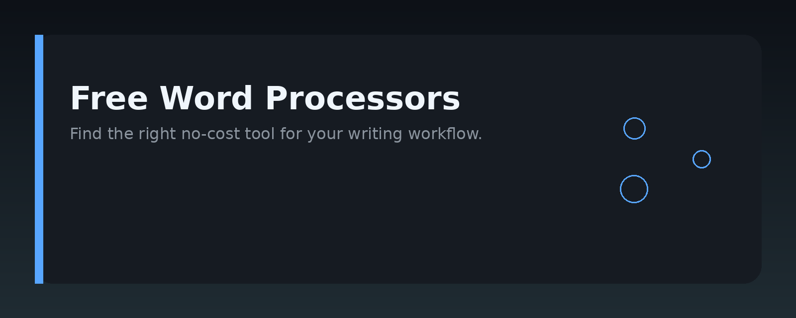
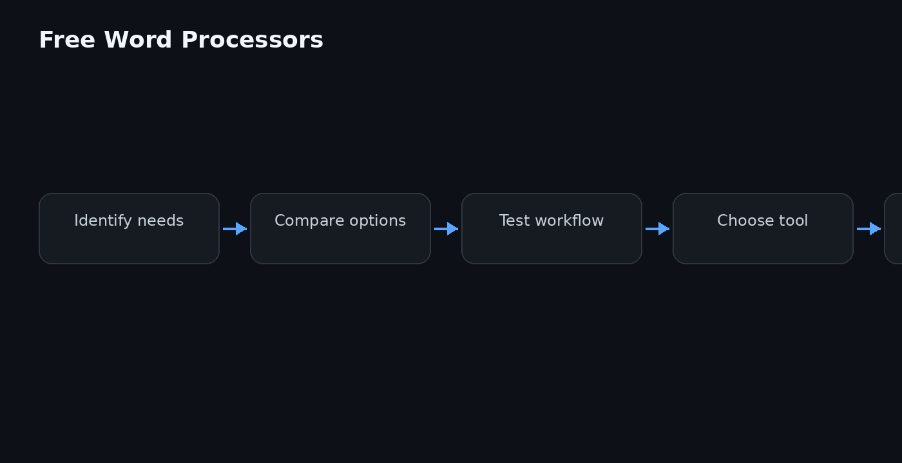

# Free Word Processors




## Overview

This repository is a practical guide to free word processors: open-source and no-cost applications you can use to write, edit, format, and export documents without paying for a license. It covers the main options, how they differ, and how to choose one for your workflow.

The guide is aimed at students, writers, small businesses, and anyone who wants a capable word processor without a subscription. It focuses on software that is genuinely free to use, not trial versions or freemium tiers that lock core features.

## Why it exists

Most people reach for a paid office suite out of habit, not because it is the only option. Free word processors have matured to the point where they handle everyday writing, formatting, citations, and collaboration well. This repository exists to:

- Reduce the search effort when picking a free word processor.
- Explain the real differences between the major free options.
- Provide concrete setup and workflow steps, not just feature lists.
- Help you migrate existing documents without losing formatting.

It does not rank products with scores or claim any single tool is best for everyone. The right choice depends on your platform, file format needs, and whether you work offline or in a browser.

## Core concepts

A free word processor is any application that lets you create and edit text documents at no cost. The main concepts to understand:

- **File formats**: Most free word processors default to ODT (OpenDocument Text) but can open and save DOCX, RTF, and plain text. Compatibility varies, so test before committing.
- **Local vs. cloud**: Desktop apps store files on your machine; web-based word processors save to a server and often add real-time collaboration.
- **Offline capability**: Some free web word processors work only with an internet connection. Desktop apps work fully offline.
- **Export options**: PDF export is standard. Some tools also export EPUB, HTML, or Markdown.
- **Extensions and templates**: Many free word processors support plugins, macros, and downloadable templates that extend functionality.

Understanding these concepts helps you evaluate a free word processor against your actual needs rather than its marketing page.

## Architecture

The architecture of a typical free word processor can be understood at three layers:

- **User interface layer**: Menus, toolbars, ribbon or sidebar, and the document canvas. This is what you interact with.
- **Document model layer**: The internal representation of text, styles, images, tables, and page layout. This layer handles undo history and formatting logic.
- **I/O and export layer**: Handles reading and writing file formats (ODT, DOCX, PDF, etc.), printing, and cloud sync if applicable.

Below is a simplified view of how these layers interact:

```
+---------------------------+
|   User Interface Layer    |
|  (menus, canvas, panels)  |
+------------+--------------+
             |
             v
+---------------------------+
|   Document Model Layer    |
| (styles, layout, history) |
+------------+--------------+
             |
             v
+---------------------------+
|   I/O and Export Layer    |
| (ODT, DOCX, PDF, print)   |
+---------------------------+
```

For web-based free word processors, the document model and I/O layer run on a server, while the interface runs in your browser. This separation is why browser-based tools feel instant on any device but require connectivity.

## Practical workflow

A reliable workflow when adopting a free word processor:

1. **Identify your primary file format**. If you exchange files with people using paid office suites, test how your chosen free word processor handles DOCX round-trips.
2. **Start with a short document**. Create a one-page file with headings, bold text, a table, and an image. Export it to PDF and DOCX to check for layout issues.
3. **Set up autosave and backups**. Enable autosave if available, and configure a cloud folder or external drive for regular backups.
4. **Learn keyboard shortcuts for your top actions**. Common ones include bold, italic, undo, save, and find/replace. This saves time over menu navigation.
5. **Use templates for repetitive work**. Most free word processors ship with templates for letters, resumes, and reports. Customize one and save it as your default.
6. **Test collaboration if you need it**. If you work with others, try the real-time editing features in a web-based free word processor before relying on it for a project.

## Examples

Here are practical examples of using a free word processor from the command line or via automation, which is useful for batch conversions and scripting.

**Convert a DOCX file to PDF using LibreOffice (headless mode):**

```bash
soffice --headless --convert-to pdf report.docx
```

**Convert multiple files in a folder:**

```bash
soffice --headless --convert-to pdf --outdir ./output ./docs/*.docx
```

**Extract text from a document using Python and the `python-docx` library:**

```python
from docx import Document

doc = Document("notes.docx")
for para in doc.paragraphs:
    print(para.text)
```

**Create a simple ODT document programmatically with Python and `odfpy`:**

```python
from odf.opendocument import OpenDocumentText
from odf.text import P

doc = OpenDocumentText()
p = P(text="Hello from a free word processor")
doc.text.addElement(p)
doc.save("hello.odt")
```

These examples show that free word processors are not just GUI tools; they can be driven by scripts for automation and integration into larger workflows.

## FAQ

**Is a free word processor really free for commercial use?**  
Most major free word processors are released under open-source licenses (such as MPL, GPL, or Apache) that permit commercial use without payment. Always check the license of the specific tool you choose.

**Can I open Microsoft Word files with a free word processor?**  
Yes. Most free word processors can open and save DOCX files. Formatting fidelity is generally good, but complex documents with heavy macros or unusual fonts may render differently.

**Do free word processors support collaboration?**  
Some do. Web-based free word processors often include real-time co-editing and commenting. Desktop-only free word processors typically lack built-in collaboration, but you can work around this with shared folders or version control.

**Will my documents be private if I use a web-based free word processor?**  
That depends on the provider. Some store files on their servers, others offer end-to-end encryption or local-only storage. Read the privacy policy and consider self-hosting options if confidentiality matters.

**How do I migrate from a paid office suite?**  
Export your documents to DOCX or ODT, open them in the free word processor, and verify formatting. For spreadsheets and presentations, test compatibility separately since those formats differ more from text documents.

**Can I use a free word processor offline?**  
Yes, if you choose a desktop application. Web-based free word processors may offer offline modes, but this is not guaranteed and should be verified before relying on it.

## License

MIT License

Copyright (c) 2024 free-word-processor-guide contributors

Permission is hereby granted, free of charge, to any person obtaining a copy
of this software and associated documentation files (the "Software"), to deal
in the Software without restriction, including without limitation the rights
to use, copy, modify, merge, publish, distribute, sublicense, and/or sell
copies of the Software, and to permit persons to whom the Software is
furnished to do so, subject to the following conditions:

The above copyright notice and this permission notice shall be included in all
copies or substantial portions of the Software.

THE SOFTWARE IS PROVIDED "AS IS", WITHOUT WARRANTY OF ANY KIND, EXPRESS OR
IMPLIED, INCLUDING BUT NOT LIMITED TO THE WARRANTIES OF MERCHANTABILITY,
FITNESS FOR A PARTICULAR PURPOSE AND NONINFRINGEMENT. IN NO EVENT SHALL THE
AUTHORS OR COPYRIGHT HOLDERS BE LIABLE FOR ANY CLAIM, DAMAGES OR OTHER
LIABILITY, WHETHER IN AN ACTION OF CONTRACT, TORT OR OTHERWISE, ARISING FROM,
OUT OF OR IN CONNECTION WITH THE SOFTWARE OR THE USE OR OTHER DEALINGS IN THE
SOFTWARE.